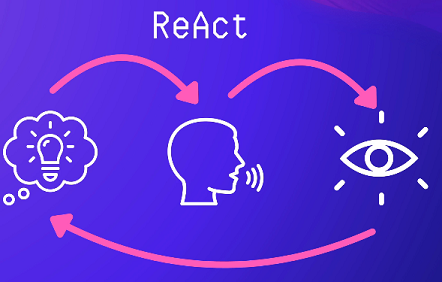

# PATRONES DE DISEÑO AGÉNTICO

## Patrón

Es una regularidad reconocible


## Patrón de Diseño

Es una solución reutilizable a un problema que se repite en un contexto determinado.

## Patrón de Diseño Agéntico

Es una solución reutilizable a un problema al que un agente de IA se enfrenta.

> - **Ejemplo**:

```bash
Prompt: Dame mis 5 mejores productos y Cuánto sería un 20% de descuento?
```

Sin un contexto la IA no puede responder este problema, para esto existen un patrones que ayudan a resolver problemas, por ejemplo:

> - **`Tool Use Pattern`** que permite a la `IA` herramientas cuando tenga un problema en particular y las pueda utilizar.

> - **`ReAct`** que es razonamiento en un bucle o ciclo: `Piensa`, `Actúa`, `Observa` el resultado, `Vuelve a pensar`.



> - **`Circuit Breaker`**: Se puede usar junto a `ReAct`, evita que el ciclo sea infinito en algunos casos

> - **`Human en the loop`**: Puntos de aprobación explícitos antes de acciones irreversibles.

Hay muchos `Patrones Agénticos`, se pueden crear y descubrir más.

### Ciclo

1. Pedirle a la IA que haga algo
2. Observar resultados (normalmente fallará)
3. Aplicar un patrón agéntico
4. Observar resultados considerablemente mejores o exitosos.

**IMPORTANTE**: No es buena idea aprender `Herramientas`. Las `Herramientas` y `modelos` cambian, los patrones no.
